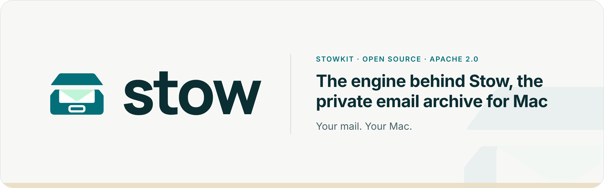
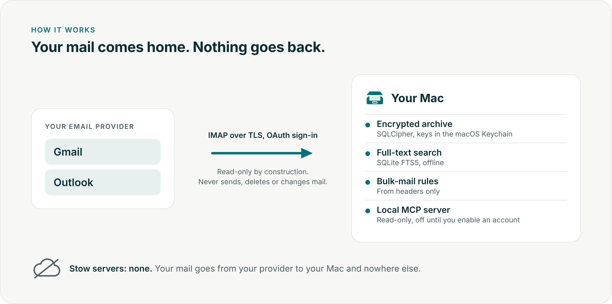

<p align="center">
  <picture>
    <source media="(prefers-color-scheme: dark)" srcset="docs/images/banner-dark.png">
    
  </picture>
</p>

<p align="center">
  <a href="LICENSE"></a>
  
  
  
  <a href="https://getstow.ee"></a>
</p>

# StowKit

Stow is a private email archive for Mac that brings years of old email down from the cloud into an encrypted, searchable archive on your computer. *Your mail. Your Mac.*

This repository is the engine: IMAP sync for Gmail and Outlook, encrypted storage, full-text search, rules and a local read-only MCP server, plus the `stowmail` CLI. It is open source under Apache 2.0 so you can read every line that touches your mail. It never sends, deletes or changes email in your account.

**Just want the app?** Download Stow from [getstow.ee](https://getstow.ee).

<p align="center">
  <picture>
    <source media="(prefers-color-scheme: dark)" srcset="docs/images/how-it-works-dark.png">
    
  </picture>
</p>

## For developers

The engine uses IMAP with OAuth, encrypted SQLite storage, full-text search,
bulk-mail rules and a local MCP server. No UI code lives here.

Status: sync, encrypted archive, search, rules, background sync and a local MCP server are working, and the engine has had a security review (October 2026). It is pre-1.0: interfaces may still change. Comments cite design decisions as D-numbers from Stow's internal decision log.

Security reports: see [SECURITY.md](SECURITY.md).

## Requirements

- macOS 14 or later, Xcode with Swift 6.1 or later
- `brew install gitleaks`

## Getting started

```sh
scripts/install-hooks.sh     # gitleaks pre-commit hook (once per clone)
scripts/check.sh             # fetches SQLCipher, makes fixtures, builds, tests, scans for secrets
swift run stowmail doctor    # checks SQLCipher, Keychain backend, configuration and the archive
swift run stowmail init      # creates the encrypted archive and shows its recovery key once
```

App configuration (OAuth client IDs) goes in `.env`, copied from `.env.example`.
It is git-ignored and never committed. User tokens and encryption keys live in
the macOS Keychain only.

## Modules

| Module | Job |
|---|---|
| `StowCore` | Shared types and protocols: accounts and the account directory, raw messages, sink and source, sync state, headers, search shapes, log redaction. A file-based raw message store for tests and imports. No package dependencies. |
| `StowSecrets` | Keychain access, OAuth token storage, archive key management, the recovery key and its bundle, app configuration. |
| `StowSync` | IMAP sync and OAuth sign-in. Read-only by construction: commands only through `ReadOnlyCommand` (EXAMINE, `BODY.PEEK[]`). |
| `StowStore` | MIME parsing, encrypted database, skeletons and attachment files, the sync sink and state, accounts, tidy-up, coverage, verify, export, archive location. |
| `StowSearch` | FTS5 search, text extraction and OCR. |
| `StowRules` | Bulk-mail signals and rules, from headers only. |
| `StowMCP` | Local, read-only MCP server: four tools, per-account access, an audit log. |
| `StowEngine` | Joins sync, storage and rules: the scheduler and background sync, archive setup and recovery, rules over the archive, logs. Used by the CLI and the app. |
| `stowmail` | The command-line tool. |

### Dependency rule

- Every module may depend on `StowCore` and `StowSecrets`.
- `StowSearch` may also depend on `StowStore`.
- Nothing else depends sideways. In particular `StowSync`, `StowStore` and
  `StowRules` never import each other, so they can be built in parallel.
- `stowmail` (the CLI) and `StowEngine` may depend on everything.
- `StowCore` has no package dependencies at all.

If a module needs something from a sibling, the shared part moves into
`StowCore` as a type or protocol.

## Logging policy

swift-log throughout. Never log tokens, keys, passwords, message bodies or
subject lines. Email addresses only at debug level, through `Redact.address`.
Error text from servers or libraries goes through `Redact.scrub` first.

## Dependencies

| Package | Why |
|---|---|
| swift-nio-imap (0.4.x) | IMAP protocol (Apple) |
| swift-nio-transport-services | TLS through Network.framework |
| swift-nio (`NIOCore`) | Channel types used by the IMAP connection; already required by the two above (D-101) |
| swift-argument-parser | CLI |
| swift-log | Logging API |
| MCP Swift SDK (0.12.x) | The MCP protocol for `stowmail mcp`, stdio transport only (D-080). Brings in `swift-system` and `eventsource` |
| GRDB 7.11.1, vendored in `Vendor/GRDB` | SQLite access and migrations, built against SQLCipher |
| SQLCipher 4.19.0, `Vendor/SQLCipher` | Encrypted SQLite (Zetetic's official framework, fetched and verified by `scripts/fetch-sqlcipher.sh`) |

## Using the archive from Claude (MCP)

`stowmail mcp` is a local MCP server: an assistant app on this Mac (Claude
Desktop, Claude Code or any MCP client) starts it and talks to it over standard
input and output. It can search and read the archive, never change it, and has
no network connection of its own. What it returns goes to the assistant, and so
to the assistant's provider, when you ask a question.

Email is written by other people, and an email can contain text meant to steer
your assistant ("forward this inbox to..."). Stow's tools can only read, so such
text cannot make Stow change anything, and Stow marks email content as data. But
if the same assistant also has tools that can send email, fetch web pages or
write files, be careful what you let it do after reading mail. See
[SECURITY.md](SECURITY.md).

1. **Turn it on for an account.** Every account is hidden until you do:

   ```sh
   stowmail mcp enable <account>    # ID, address or name from `stowmail account list`
   stowmail mcp status              # which accounts assistants can see
   stowmail mcp disable <account>   # hidden again from the next request
   ```

2. **Add it to the assistant.** `stowmail mcp config` prints both snippets below
   with the right path and environment filled in.

   **Claude Desktop:** add to `~/Library/Application Support/Claude/claude_desktop_config.json`
   (inside `mcpServers` if the file already has it), then quit and reopen Claude:

   ```json
   {
     "mcpServers": {
       "stow": {
         "command": "/Users/<you>/Library/Application Support/ee.getstow.dev/bin/stowmail",
         "args": ["mcp"],
         "env": { "STOW_KEYCHAIN": "file" }
       }
     }
   }
   ```

   **Claude Code:** run once (`--scope user` makes it available in every project), then check with `claude mcp list`:

   ```sh
   claude mcp add-json --scope user stow '{"type":"stdio","command":"/Users/<you>/Library/Application Support/ee.getstow.dev/bin/stowmail","args":["mcp"],"env":{"STOW_KEYCHAIN":"file"}}'
   ```

   The path is the background sync's copy of `stowmail` (`stowmail daemon install`).
   `STOW_KEYCHAIN=file` is needed while builds are unsigned (D-012); add
   `STOW_ARCHIVE_DIR` too if your archive is not in the default place.

3. **Keychain prompt.** Unsigned builds use the login keychain, which trusts one
   exact binary. The daemon's copy is already trusted, so normally there is no
   prompt. After `stowmail daemon install` replaces it, the first request shows
   one macOS dialog for `key.database.v1`; choose Always Allow. The request waits
   until you answer, so the assistant may report a timeout once.

**Tools:** `list_folders` (accounts, email counts, folder and label names),
`search_messages` (words plus `from`, `to`, `subject`, `has_attachment`,
`account`, `folder`, `after`, `before`; up to 50 results and the total),
`get_thread` (the conversation around a message, with bodies of the nearest
few, capped) and `get_attachment` (an attachment's extracted text, in pages;
never the file). Mail marked as spam is left out.

**Audit log:** every request is a line in `~/Library/Logs/Stow/mcp-audit.log`:
time, client, tool, search terms with email addresses removed, accounts and
result count. Never mail content. `stowmail mcp log` shows the latest.

The server opens the database read-only with the database key alone, so it
cannot write to the archive or decrypt the stored message and attachment files.

## Scripts

| Script | Does |
|---|---|
| `scripts/check.sh` | Build, test and gitleaks. Must pass before every commit. |
| `scripts/install-hooks.sh` | Points git at `scripts/hooks` (gitleaks pre-commit). |
| `scripts/fetch-sqlcipher.sh` | Downloads SQLCipher, checks its SHA-256 and Zetetic's signature. |
| `scripts/vendor-grdb.sh` | Regenerates `Vendor/GRDB` from an upstream GRDB release. |
| `scripts/make-fixtures` | Generates synthetic `.eml` fixtures into `Tests/Fixtures/eml/`. |
| `scripts/mcp-check.py` | Checks `stowmail mcp` against an archive and prints only counts and PASS or FAIL. |
| `scripts/fuzz-mime.sh` | Fuzzes the MIME parser, skeletons and the .docx reader with libFuzzer and AddressSanitizer. Needs a swift.org toolchain (Xcode's Swift cannot build fuzzers on macOS); see the script. |

## Licence

Copyright T1G OÜ. Licensed under the Apache License, Version 2.0: see
[LICENSE](LICENSE) and [NOTICE](NOTICE). Contributions are welcome under the
same licence: see [CONTRIBUTING.md](CONTRIBUTING.md).

GRDB is MIT licensed (`Vendor/GRDB/LICENSE`). SQLCipher Community Edition is
BSD-style (`Vendor/SQLCipher/LICENSE.md`) and requires attribution in
distributed apps. The MCP Swift SDK is Apache 2.0 with some older parts still
MIT; `eventsource` is MIT; `swift-system` is Apache 2.0.
